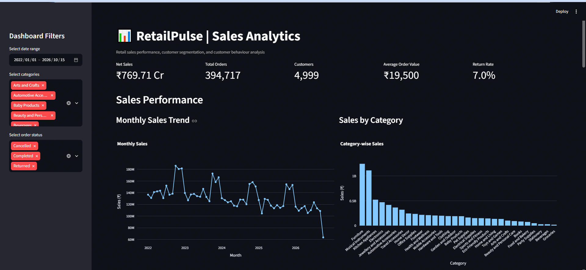
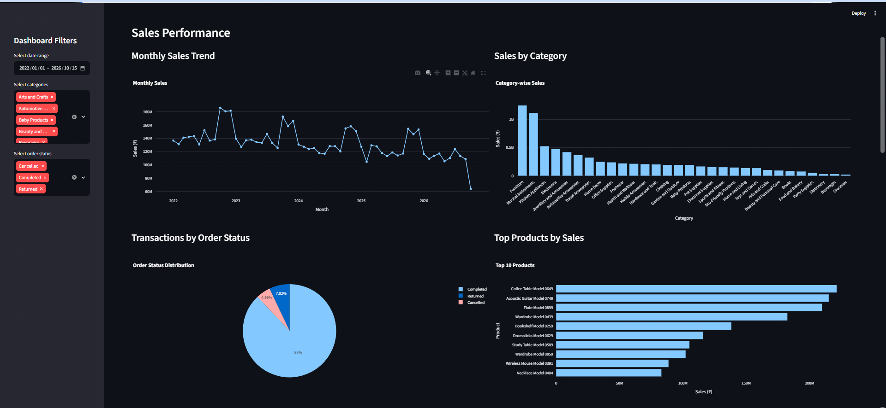
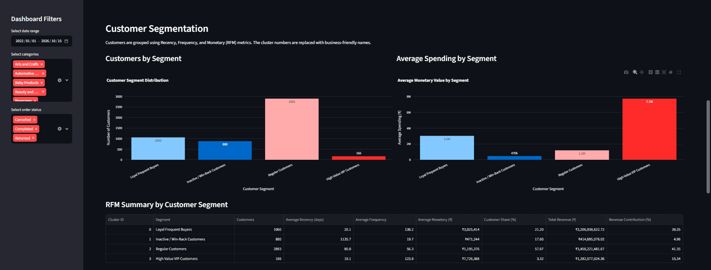
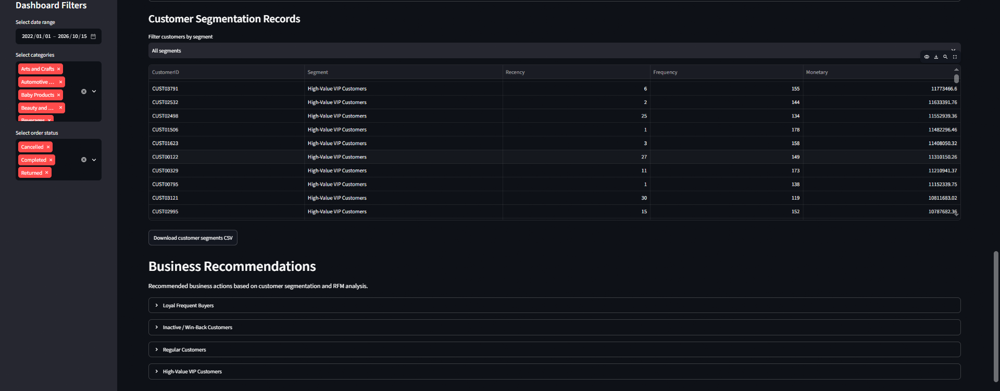
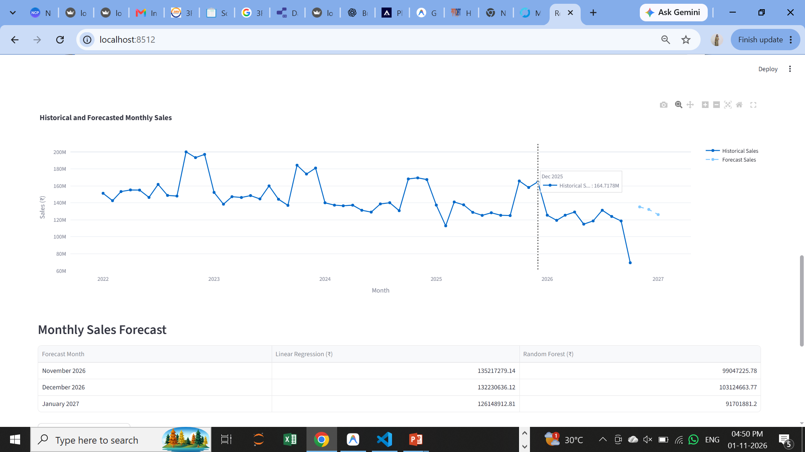
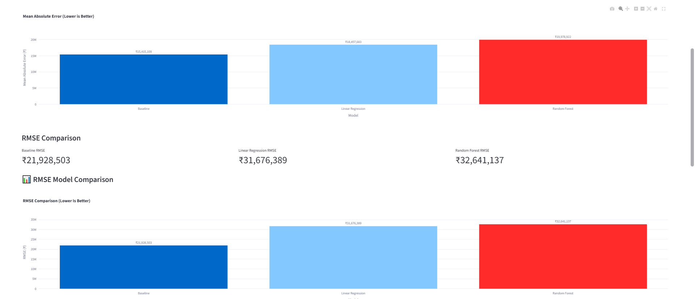
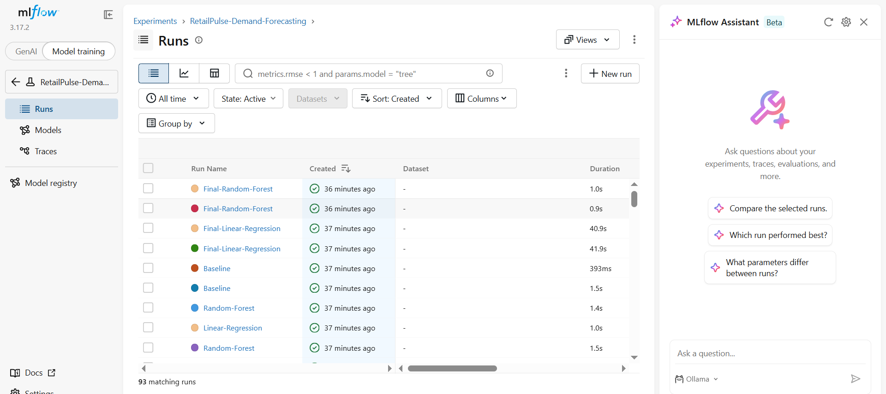

# RetailPulse — AI-Powered Customer Analytics & Demand Forecasting Platform

## Project Overview

RetailPulse is a Python-based data science and analytics project designed to help retail businesses understand sales performance, customer purchasing behaviour, and future sales demand.

The project combines data cleaning, exploratory data analysis (EDA), interactive dashboards, RFM-based customer segmentation, customer churn prediction, inventory analysis, and machine learning-based demand forecasting.

It provides two interactive Streamlit dashboards:

1. **Sales Analytics Dashboard:** Analyzes sales performance, order status, product and category performance, customer segments, and business recommendations.
2. **Demand Forecasting Dashboard:** Uses historical monthly sales data to forecast future sales and compare machine learning models.

The platform uses Python, Pandas, NumPy, Streamlit, Plotly, Scikit-learn, and MLflow to generate meaningful insights and support data-driven business decisions.

The dataset used in this project is synthetic and intended for educational and portfolio purposes.

---

## Project Objectives

- Analyze retail sales performance.
- Track monthly sales trends and category performance.
- Understand order status distribution.
- Identify top-performing products.
- Analyze customer purchasing behaviour.
- Segment customers using Recency, Frequency, and Monetary (RFM) metrics.
- Explore customer churn prediction.
- Forecast future monthly sales using machine learning.
- Compare model performance using MAE and RMSE.
- Track machine learning experiments and model versions using MLflow.
- Generate actionable business recommendations.

---

## Tools and Technologies

| Technology | Purpose |

| Python | Programming and data analysis |
| Pandas | Data cleaning and manipulation |
| NumPy | Numerical operations |
| Streamlit | Interactive web dashboards |
| Plotly | Interactive data visualizations |
| Scikit-learn | Machine learning and predictive modelling |
| MLflow | Experiment tracking and model management |
| Excel | Business reporting and analysis |
| Git and GitHub | Version control and project hosting |

---

## Project Modules

### 1. Sales Analytics Dashboard

The sales analytics dashboard provides an overview of retail business performance.

**Key features:**
- Interactive date, category, and order-status filters.
- Sales KPI cards.
- Monthly sales trend analysis.
- Sales by category.
- Order status distribution.
- Top-performing products.
- Customer purchasing behaviour analysis.
- Downloadable Excel business report.

### 2. Customer Segmentation

Customer segmentation is performed using the RFM model.

The three RFM metrics are:

- **Recency:** How recently a customer made a purchase.
- **Frequency:** How often a customer makes purchases.
- **Monetary:** The total amount spent by a customer.

The project identifies four customer segments:

1. Loyal Frequent Buyers
2. Inactive / Win-Back Customers
3. Regular Customers
4. High-Value VIP Customers

These segments help businesses understand customer behaviour and develop suitable retention and loyalty strategies.

### 3. Customer Churn Prediction

The project includes a customer churn prediction module to explore customer retention and identify customers who may stop purchasing.

### 4. Inventory Analysis and Optimization

The project includes an inventory optimization module to support inventory-related analysis and business decision-making.

### 5. Demand Forecasting

The demand forecasting module predicts future monthly sales using historical sales data.

**Machine learning models compared:**

- Baseline Model
- Linear Regression
- Random Forest Regression

**Model evaluation metrics:**

- **MAE (Mean Absolute Error):** Measures the average absolute difference between actual and predicted sales.
- **RMSE (Root Mean Squared Error):** Measures prediction errors while giving greater weight to larger errors.

Lower MAE and RMSE values indicate better model performance when models are evaluated on the same test dataset.

The dashboard displays:
- Historical monthly sales.
- Future monthly sales predictions.
- Linear Regression forecasts.
- Random Forest forecasts.
- MAE comparison chart.
- RMSE comparison chart.
- Forecast results table.
- Downloadable sales forecast CSV.

### 6. MLflow Experiment Tracking

MLflow is integrated into the demand forecasting module to track machine learning experiments.

It is used for:

- Tracking model parameters.
- Logging evaluation metrics.
- Recording model runs.
- Logging trained model artifacts.
- Registering trained models.
- Managing model versions.

The registered Random Forest model is used for forecasting in the demand forecasting module.

---

## Dashboard Screenshots

Add your project screenshots inside the `screenshots/` folder and use the following image paths.

### 1. Sales Dashboard Overview



### 2. Sales Analysis



### 3. Customer Segmentation



### 4. Business Recommendations



### 5. Demand Forecasting



### 6. Model Performance Comparison



### 7. MLflow Model Tracking



---

## Project Structure

The following is an illustrative project structure. Update it if your actual folder names or files differ.

```text
RetailPulse/
│
├── app.py
├── generate_dataset.py
├── clean_data.py
├── eda_analysis.py
├── customer_segmentation.py
├── churn_prediction.py
├── inventory_optimization.py
├── demand_forecasting.py
├── mlflow_test.py
│
├── data/
│   └── transactions.csv
│
├── analysis/
│   └── charts/
│
├── screenshots/
│   ├── dashboard_overview.png
│   ├── sales_analysis.png
│   ├── customer_segmentation.png
│   ├── business_recommendations.png
│   ├── demand_forecasting.png
│   ├── model_comparison.png
│   └── mlflow_tracking.png
│
├── requirements.txt
├── README.md
└── .gitignore
```

---

## Installation and Setup

### 1. Clone the Repository

```bash
git clone YOUR_GITHUB_REPOSITORY_URL
```

### 2. Navigate to the Project Folder

```bash
cd RetailPulse
```

### 3. Create a Virtual Environment

```bash
python -m venv .venv
```

### 4. Activate the Virtual Environment

For Windows PowerShell:

```powershell
.\.venv\Scripts\Activate.ps1
```

### 5. Install Required Packages

```bash
python -m pip install -r requirements.txt
```

### 6. Generate the Dataset

```bash
python generate_dataset.py
```

### 7. Clean the Data

```bash
python clean_data.py
```

### 8. Run Exploratory Data Analysis

```bash
python eda_analysis.py
```

### 9. Run Customer Segmentation

```bash
python customer_segmentation.py
```

### 10. Run Customer Churn Prediction

```bash
python churn_prediction.py
```

### 11. Launch the Sales Analytics Dashboard

```bash
python -m streamlit run app.py
```

### 12. Launch the Demand Forecasting Dashboard

Open another terminal and run:

```bash
python -m streamlit run demand_forecasting.py --server.port 8511
```

### 13. Launch the MLflow Tracking UI

Open another terminal and run:

```bash
mlflow ui --backend-store-uri sqlite:///mlflow.db --host 127.0.0.1 --port 5000
```

Open the following address in your browser:

```text
http://localhost:5000
```

**Note:** Run the scripts in the required order based on your project setup. If the datasets and output files have already been generated, you can launch the dashboards directly.

---

## Business Benefits

RetailPulse demonstrates how data analytics and machine learning can support retail business decisions.

- Better understanding of sales performance.
- Identification of high-value customers.
- Improved customer retention strategies.
- Identification of sales trends.
- Better understanding of product performance.
- Future sales demand estimation.
- Comparison of forecasting model performance.
- Data-driven business recommendations.

---

## Skills Demonstrated

- Python Programming
- Data Cleaning and Preprocessing
- Exploratory Data Analysis (EDA)
- Data Visualization
- Pandas and NumPy
- Streamlit Dashboard Development
- Customer Segmentation using RFM
- Machine Learning Fundamentals
- Sales Demand Forecasting
- Model Evaluation using MAE and RMSE
- MLflow Experiment Tracking
- Business Analysis and Reporting

---

## Future Enhancements

- Deploy the dashboards to a cloud platform.
- Add automated data pipelines.
- Improve forecasting accuracy with additional features and models.
- Implement model monitoring and drift detection.
- Add real-time data integration.
- Improve inventory demand planning.

---

## Disclaimer

RetailPulse is an educational data science and analytics portfolio project developed using synthetic retail data. The results are intended to demonstrate data analytics, visualization, and machine learning concepts. They do not represent the actual performance of a real retail business.

---

## Author

**Trupti Ashok Sarve**

Data Science and Analytics Learner

Project: RetailPulse — AI-Powered Customer Analytics & Demand Forecasting Platform